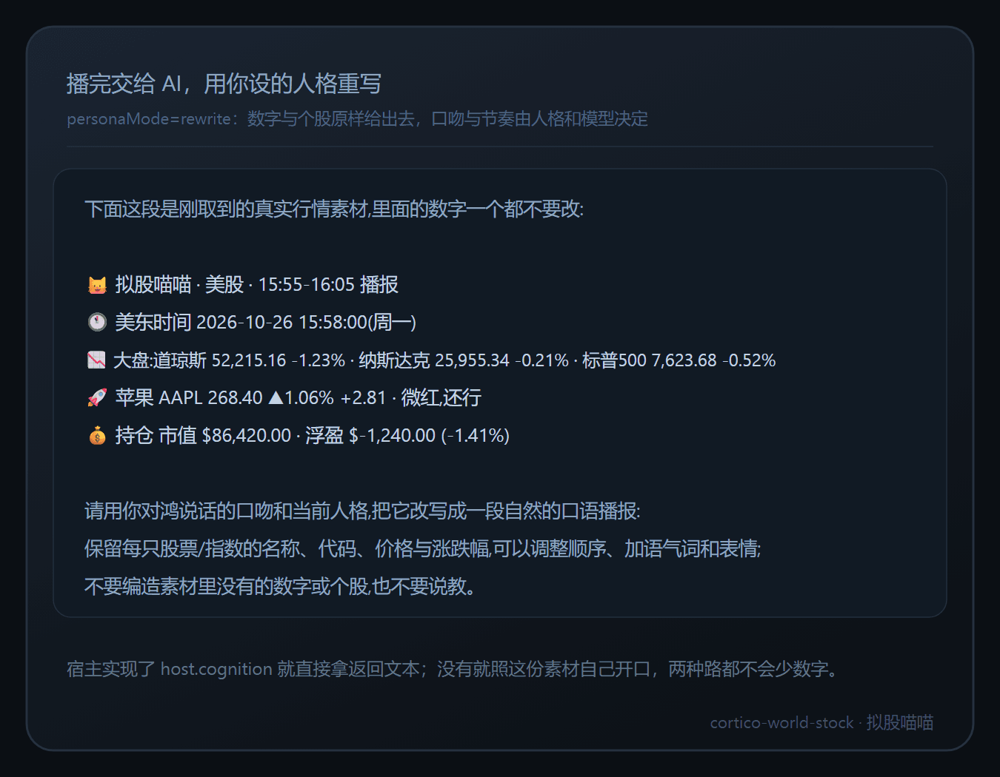
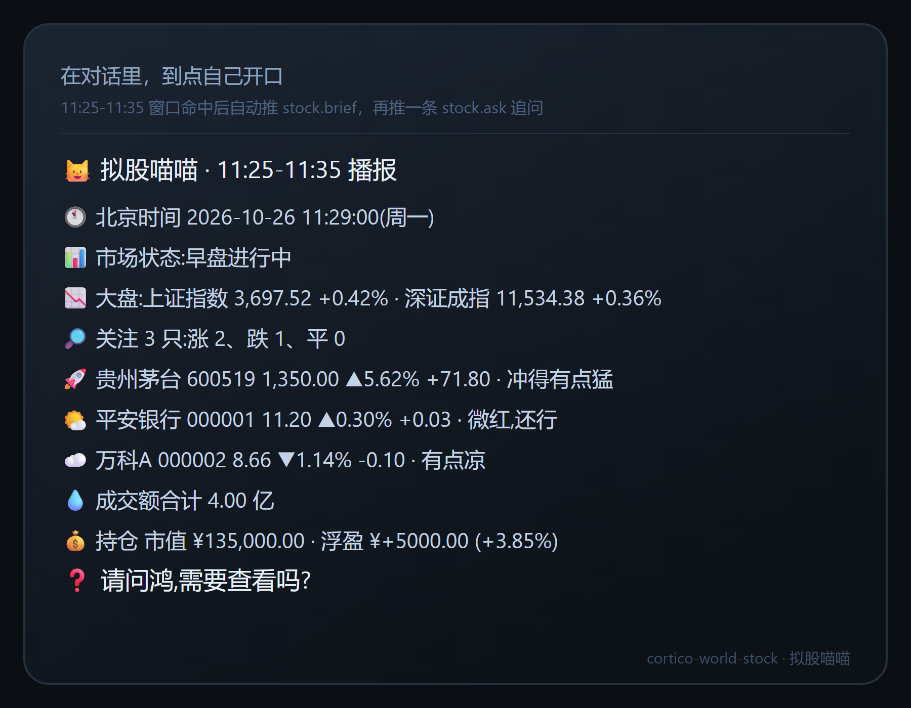
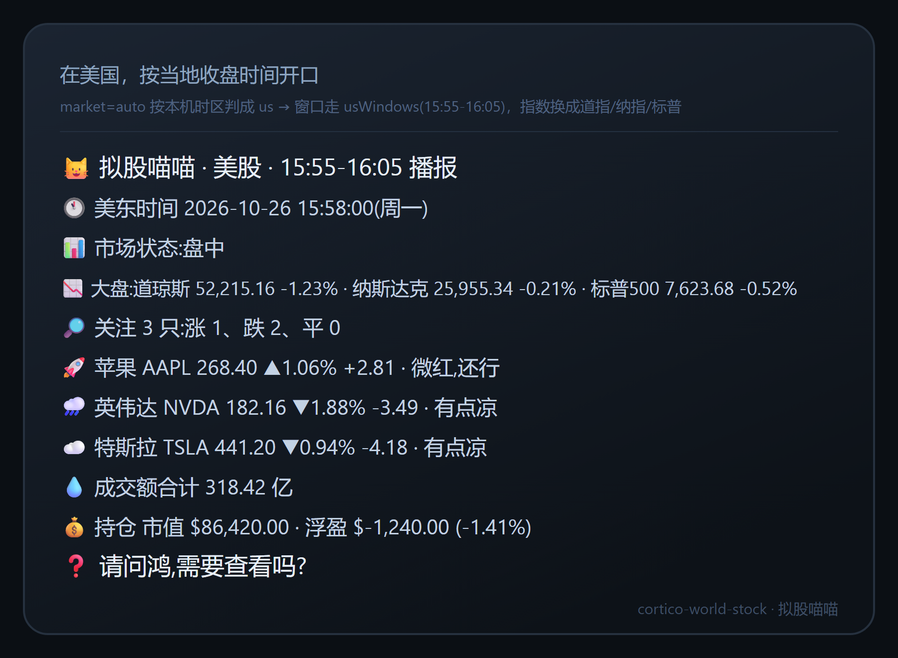

# 拟股喵喵 · cortico-world-stock

[](https://www.npmjs.com/package/cortico-world-stock)
[](./LICENSE)
[](https://nodejs.org)
[](https://github.com/Pal-AI-Lab/cortico)


按本地时区在市场窗口播报行情。覆盖自选股与大盘指数，A 股与美股可切换，指数清单可自定义；接入账户后可选播报持仓盈亏；文案可按设定人格改写。

- **先对时**：每次开工先定本机时区与当前时间，市场时钟按生效市场算（A 股 `Asia/Shanghai`、美股 `America/New_York`），每条播报都带这句，不会拿错日期做判断。
- **只报真数**：指数与个股全部来自公开行情接口；取不到就说没取到，绝不凭记忆编数字。
- **指数可配**：`indexList` / `usIndex` 自己填，默认已经含科创 50。
- **境外自动切**：`market=auto` 时，时区是 `America/*` 就判成美股 —— 换美股窗口、换美股指数。
- **持仓可选**：不接、手填、或读券商导出的 CSV；`briefScope` 还能选只播盈亏。
- **人格化**：`personaMode=rewrite` 时，播报由 AI 按你给桌宠的人格重写，但数字与个股不许改。
- **说话好玩**：▲▼ 箭头加九档表情短语，风格可切 `lively` / `calm`。

*Cortico World · `kind: world` · `api: 6` · `tags: companion / internet` · MIT · 107 项单测通过、契约校验通过*

## 目录

- [为什么需要它](#为什么需要它)
- [安装](#安装)
- [配置](#配置)
- [工具](#工具)
- [事件](#事件)
- [时区与市场](#时区与市场)
- [播报窗口与打卡](#播报窗口与打卡)
- [指数清单](#指数清单)
- [数据源](#数据源)
- [持仓与播报范围](#持仓与播报范围)
- [人格化播报](#人格化播报)
- [播报长什么样](#播报长什么样)
- [验证](#验证)
- [限制](#限制)
- [配图](#配图)
- [许可](#许可)

## 为什么需要它

桌宠在后台的时候你未必盯着行情软件。它在窗口内自己开口，你不问也能知道手上的票今天什么姿势；人在国外也不必换算时差 —— 它按你当地的收盘时间说美股。想细看再问一句，不想看它就闭嘴。

## 安装

面板安装（推荐）：

1. 打开 Coopanion WebUI（端口以 `config.json` 的 `web.port` 为准，默认 `17788`），进入**高级模式 → 扩展**。
2. 在扩展市场搜 `cortico-world-stock`，或在**手动安装**里选「从 npm 安装」填包名。
3. 安装后重启 Coopanion：扩展在宿主启动时扫描，新装的处于 `pending-restart`。
4. 进 **World 总览** 打开「拟股喵喵」；面板路由是 `#/provider/world%3Astock`。
5. 在 World 面板里配关注列表、市场与播报窗口，标了 `x-hot` 的项改完即时生效。

从源码装（开发期）：把包目录以 `link:` 形式写进 `extensions/package.json` 的 `dependencies`，再重启 Coopanion —— 宿主只认 `dependencies`，光在 `node_modules` 建链接不会被发现。

## 配置

面板里的键名是 `worlds.stock.<key>`，标了 `x-hot` 的改完即时生效。

| 键 | 默认 | 说明 |
| --- | --- | --- |
| `autoBrief` | `true` | 自动播报总开关。关掉只剩手动工具可用 |
| `user` | 空 | 播报里怎么称呼你；空则退回 `worlds.desktop-pet.user`，再空用「你」 |
| `dataSource` | `auto` | `eastmoney` / `ths` / `auto`（先东财整批，失败逐只退同花顺） |
| `watchlist` | `600519,000001` | 逗号分隔，最多 `maxWatch` 只；美股写字母代码如 `AAPL,DJIA` |
| `market` | `auto` | 生效市场：`auto` 按本机时区猜（`America/*` → 美股），也可钉死 `cn` / `us` |
| `indexList` | `sh000001,sz399001,sz399006,sh000688` | A 股指数清单：沪指 / 深成 / 创业板 / 科创 50 |
| `usIndex` | `DJIA,NDX,SPX` | 美股指数清单：道指 / 纳指 / 标普 500；字母代码或 `100.DJIA` 都认 |
| `showIndex` | `true` | 播报里带不带大盘那行 |
| `briefWindows` | `11:25-11:35,14:55-15:05` | A 股播报窗口，按北京时间，含两端 |
| `usWindows` | `15:55-16:05` | 美股播报窗口，按美东时间，含两端 |
| `askAfterBrief` | `true` | 播完追问一句 |
| `briefScope` | `both` | 播什么：`both` 关注+持仓 / `watch` 只看关注 / `account` 只播持仓盈亏 |
| `style` | `lively` | `lively` 带表情短语，`calm` 只报数字 |
| `personaMode` | `rewrite` | `rewrite` 交给 AI 按人格改写；`plain` 发模板原文 |
| `trigger` | `debounce` | 事件触发方式：`flush` / `debounce` / `preempt` / `interrupt` |
| `accountMode` | `none` | `none` / `manual` / `csv` |
| `holdings` | 空 | 手填持仓，形如 `600519:100:1300.5,000001:2000:10.5`（代码:股数:成本价，成本可省） |
| `holdingsFile` | 空 | 券商导出的 CSV / TSV 路径，面板里给文件选择器 |
| `maxWatch` | `12` | 关注上限，1–50 |
| `zone` | 空 | 你的时区；空则用宿主时区。填 `America/New_York` 这类值时，市场也会跟着判成美股 |

`worlds.stock.enabled` 是框架总闸，扩展定义里恒为 `false`（由部署决定），所以面板不暴露它 —— 你在 `config.json` 里开世界，用 `autoBrief` 控制它要不要自己开口。

## 工具

| 工具 | 什么时候用 |
| --- | --- |
| `stock_setup` | 不清楚现在几点、什么市场、什么时段、数据源通不通，先问它 |
| `stock_now` | 立刻算一份播报读出来，但不推送、不打卡 |
| `stock_brief` | 手动播一次，会推送并追问 |
| `stock_watch` | 关注列表增删改查：`list` / `add` / `remove` / `set` |
| `stock_account` | 持仓：`show` / `off` / `manual` / `csv` |
| `stock_schedule` | 看窗口、今天播过没、下一段是哪个 |

## 事件

| 事件 | 含义 |
| --- | --- |
| `stock.ready` | 世界启动，附带市场、关注数量与最近一条播报摘要 |
| `stock.brief` | 一份播报，`meta` 里有市场、窗口序号与条数 |
| `stock.ask` | 播报后的追问，走 `flush` 触发 |

## 时区与市场

`resolveClock(zone, at, market)` 一次给出：市场名、你的当地时间、市场当地的时间、时区偏移、日期键、分钟数、时段。

- 市场时钟：A 股 `Asia/Shanghai`，美股 `America/New_York`。
- 市场时段：A 股早盘 09:30–11:30、午间、午盘 13:00–15:00；美股 09:30–16:00 连续成交、没有午休，所以阶段里会多出一个 `trading`（中文「盘中」）。
- `market=auto` 的判定：`zone`（或宿主时区）以 `America/` 开头就是美股，否则 A 股。
- 只有你的时区跟市场时区不同，播报里才多一行「你那边」。
- `zone` 留空时用宿主时区；给了不认识的值会退回 `Asia/Shanghai`，不会崩。

## 播报窗口与打卡

- A 股窗口 `briefWindows` 按北京时间、美股窗口 `usWindows` 按美东时间，**都含两端**。
- 支持 `11:25-11:35`、`11:25~11:35`、`11:25—11:35` 和中文逗号顿号分隔。
- 打卡落在 `<dataDir>/stock/state.json`，键是 `日期#窗口序号`：同一个交易日、同一个窗口只播一次。
- 跨日自动清空；启动时会立刻检查一次，如果正处在窗口内又没播过，会当场补上。
- 手动 `stock_brief` 不占用窗口打卡 —— 想临时看一眼不至于把正式播报吞掉。

## 指数清单

- A 股用 `indexList`，默认 `sh000001,sz399001,sz399006,sh000688` —— 上证指数、深证成指、创业板指、科创 50。
- 美股用 `usIndex`，默认 `DJIA,NDX,SPX` —— 道琼斯、纳斯达克 100、标普 500。
- 写错或写空的项会被跳过并在回执里列出认不出的部分，不会拿假数据顶上。
- `showIndex` 关掉就整行不出。

## 数据源

- **东方财富**：两条路，一条走不通自动换另一条。
  - 批量：`push2.eastmoney.com/api/qt/ulist.np/get`，一批最多 50 只，字段 `f2` 现价 / `f3` 涨跌幅 / `f4` 涨跌额 / `f18` 昨收 / `f124` 时间戳。
  - 单只：`push2.eastmoney.com/api/qt/stock/get`，字段 `f43` 现价 / `f170` 涨跌幅 / `f60` 昨收 / `f86` 时间戳。**实测某些网络会直接掐断批量接口（RST）**，插件在批量失败后逐只走这条，并发 4。
  - 两条都带 `fltt=2&invt=2`，返回就是两位小数；A 股与美股指数共用同一套字段（美股 `secid` 前缀 `100.`，成交额给 `"-"` 时按 0 算）。
- **同花顺**：`d.10jqka.com.cn/v6/time/hs_<代码>/last.js`，必须带 `Referer: https://stockpage.10jqka.com.cn/`，取分时最后一点当现价。**只有 A 股、不支持指数** —— 美股走这条路会直接报「请用 eastmoney 或 auto」。
- **auto**：先东财整批；整批失败就逐只退同花顺；两路都空才算失败，回执写「两条路都没取到行情」。
- 价格 ≤ 0 视为停牌，市值按昨收算，并在播报里标出来。

## 持仓与播报范围

- `accountMode=none`：不接，播报里只说行情。
- `manual`：`stock_account action=manual holdings=600519:100:1300.5`，全角冒号、顿号、分号都能吃。
- `csv`：读券商导出的表，表头认 `代码/code/证券`、`数量/股数/持仓/shares`、`成本/均价/cost`；引号包裹的千分位（`"¥1,300.50"`）也能读；UTF-8 解出乱码会自动按 GBK 重解一次。
- `briefScope` 决定播什么：`both` 关注 + 持仓；`watch` 只看关注；`account` 只播持仓盈亏（这时不占关注段的篇幅，关注代码仍会被取数以保证盈亏算得准）。
- 币种跟着市场走：A 股 `¥`、美股 `$`；没填成本价就只报市值，不假装有盈亏。

## 人格化播报

`personaMode=rewrite`（默认）时，播报不再直接把模板文本推出去了：

1. 先在本地算好一份完整播报（所有数字都在里面）。
2. 如果宿主实现了 `host.cognition`，就把它交过去，用返回的文本当播报正文 —— 上下文、轮数、token 预算都由人格侧掌握。
3. 没有这个通道（例如当前的 Coopanion 部署）就改成把素材连同要求一起推给会话模型：一段「这是真实行情素材，数字一个都不要改」的包装，再让模型用你设的人格改写成口语播报。
4. 两条路都失败时才退回模板原文，并在日志里记一条 warn。

数字与个股不会因为改写而变 —— 模型只换语气和顺序。想要完全固定的文案就设 `personaMode=plain`。



## 播报长什么样





追问那句是独立一条事件：`请问鸿,需要查看吗?` —— 名字取 `user`，取不到就叫「你」。

## 验证

```bash
corepack pnpm typecheck
corepack pnpm test                    # 107 项
corepack pnpm describe:extension .    # 在 cortico 仓库里跑
corepack pnpm check:extension .       # 官方契约校验
```

## 限制

- 取数只走公开网页接口，可能被限流；连续失败只记 `lastError`，不做重试轰炸。
- 东财批量接口在某些网络下会被掐断，这时自动改逐只取：七只指数也能在 1 秒内拿完，但比批量慢一些。
- 走 `ths` 时大盘那行会空着（同花顺这个接口不给指数），美股则必须走东财。
- 分时只在盘中滚动，收盘后拿到的就是当日收盘快照。
- 港股、期货、外汇都没有。
- 只做播报，不构成投资建议。

## 配图

`icon.svg` 是市场卡片的头像；`screenshots/` 四张是按真实工具回执与播报文案排版的**示意图**（不是截图）。两者都写在 `package.json` 的 `cortico.icon` 与 `cortico.screenshots` 里，随 npm 包一起走，谁上传的插件都能自带。

## 许可

MIT
