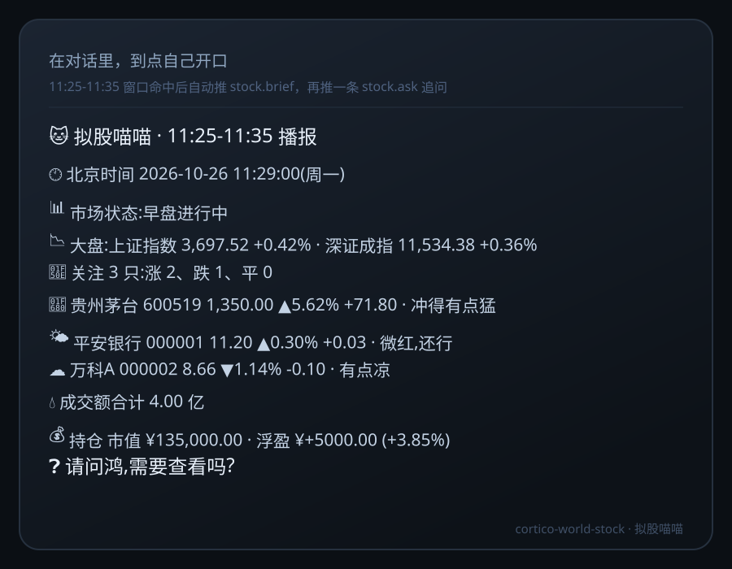

# 拟股喵喵（cortico-world-stock）

Cortico World 扩展：把 A 股行情搬进对话。桌宠在每个交易日的早盘尾、午盘尾按窗口主动开口，报你关注股票的涨跌，播完再追问一句要不要细看。

- **先对时**：每次开工都先确定时区与当前时间（市场时钟固定 `Asia/Shanghai`），后面每条播报都带这句，不会用错的日期做判断。
- **只报真数**：取不到行情就说没取到，绝不凭记忆编数字。
- **数据源自选**：东方财富 / 同花顺 / auto 回退，都在配置里换。
- **持仓可选**：不接、手填、或读券商导出的 CSV。
- **说话好玩**：▲▼ 箭头加九档表情短语，风格可切 `lively` / `calm`。

## 为什么需要它

桌宠在后台的时候你未必盯着行情软件。它在窗口内自己开口，你不问也能知道手上的票今天什么姿势；想细看再问一句，不想看它就闭嘴。

## 安装

### 从 npm 装进 Coopanion

1. 在 `Coopanion/data/extensions/package.json` 的 `dependencies` 里加 `"cortico-world-stock": "^0.1.0"`。
2. 在 `Coopanion/data/extensions` 下装依赖。
3. 改 `Coopanion/data/home/companion/config.json`，给 `worlds` 加一段：`"stock": { "enabled": true }`。
4. 重启 Coopanion —— 宿主只在启动时扫扩展，新装的一定是 pending-restart。

### 从源码（link）

把本目录以 `link:` 形式写进同一个 `dependencies`，其余同上。宿主只认 `extensions/package.json` 的 `dependencies`，光在 `node_modules` 里建链接不会被发现。

## 配置

面板里的键名是 `worlds.stock.<key>`，标了 `x-hot` 的改完即时生效。

| 键 | 默认 | 说明 |
| --- | --- | --- |
| `autoBrief` | `true` | 自动播报总开关。关掉只剩手动工具可用 |
| `user` | 空 | 播报里怎么称呼你；空则退回 `worlds.desktop-pet.user`，再空用「你」 |
| `dataSource` | `auto` | `eastmoney` / `ths` / `auto`（先东财整批，失败逐只退同花顺） |
| `watchlist` | `600519,000001` | 逗号分隔，最多 `maxWatch` 只 |
| `showIndex` | `true` | 播报里带上证、深成、创业板 |
| `briefWindows` | `11:25-11:35,14:55-15:05` | 播报窗口，按北京时间，含两端 |
| `askAfterBrief` | `true` | 播完追问一句 |
| `style` | `lively` | `lively` 带表情短语，`calm` 只报数字 |
| `trigger` | `debounce` | 事件触发方式：`flush` / `debounce` / `preempt` / `interrupt` |
| `accountMode` | `none` | `none` / `manual` / `csv` |
| `holdings` | 空 | 手填持仓，形如 `600519:100:1300.5,000001:2000:10.5`（代码:股数:成本价，成本可省） |
| `holdingsFile` | 空 | 券商导出的 CSV / TSV 路径，面板里给文件选择器 |
| `maxWatch` | `12` | 关注上限，1–50 |
| `zone` | 空 | 你的时区；空则用宿主时区 |

`worlds.stock.enabled` 是框架总闸，扩展定义里恒为 `false`（由部署决定），所以面板不暴露它 —— 你在 `config.json` 里开世界，用 `autoBrief` 控制它要不要自己开口。

## 工具

| 工具 | 什么时候用 |
| --- | --- |
| `stock_setup` | 不清楚现在几点、什么时段、数据源通不通，先问它 |
| `stock_now` | 立刻算一份播报读出来，但不推送、不打卡 |
| `stock_brief` | 手动播一次，会推送并追问 |
| `stock_watch` | 关注列表增删改查：`list` / `add` / `remove` / `set` |
| `stock_account` | 持仓：`show` / `off` / `manual` / `csv` |
| `stock_schedule` | 看窗口、今天播过没、下一段是哪个 |

## 事件

| 事件 | 含义 |
| --- | --- |
| `stock.ready` | 世界启动，附带关注数量与最近一条播报摘要 |
| `stock.brief` | 一份播报，`meta` 里有窗口序号与条数 |
| `stock.ask` | 播报后的追问，走 `flush` 触发 |

## 时区与时间怎么定

`resolveClock(zone, at)` 一次给出：你的当地时间、北京时间、时区偏移、日期键、分钟数、时段。市场时段（早盘 09:30–11:30、午间、午盘 13:00–15:00）固定按北京时间算；只有你的时区跟北京时间不同，播报里才多一行「你那边」。

`zone` 留空时用宿主时区；给了一个不认识的值会退回 `Asia/Shanghai`，不会崩。

## 播报窗口与打卡

- 窗口按北京时间算，**含两端**；支持 `11:25-11:35`、`11:25~11:35`、`11:25—11:35` 和中文逗号顿号分隔。
- 打卡落在 `<dataDir>/stock/state.json`，键是 `日期#窗口序号`：同一个交易日、同一个窗口只播一次。
- 跨日自动清空；启动时会立刻检查一次，如果正处在窗口内又没播过，会当场补上。
- 手动 `stock_brief` 不占用窗口打卡 —— 想临时看一眼不至于把正式播报吞掉。

## 数据源

- **东方财富**：`push2.eastmoney.com/api/qt/ulist.np/get`，一批最多 50 只，`fltt=2` 直接给两位小数，字段 `f2` 现价 / `f3` 涨跌幅 / `f4` 涨跌额 / `f18` 昨收 / `f124` 时间戳。最快也最干净。
- **同花顺**：`d.10jqka.com.cn/v6/time/hs_<代码>/last.js`，必须带 `Referer: https://stockpage.10jqka.com.cn/`，取分时最后一点当现价，最高最低由分时极值近似。**不支持指数**。
- **auto**：先东财整批；整批失败就逐只退同花顺；两路都空才算失败，回执写「两条路都没取到行情」。
- 价格 ≤ 0 视为停牌，市值按昨收算，并在播报里标出来。

## 持仓

- `none`：不接，播报里只说行情。
- `manual`：`stock_account action=manual holdings=600519:100:1300.5`，全角冒号、顿号、分号都能吃。
- `csv`：读券商导出的表，表头认 `代码/code/证券`、`数量/股数/持仓/shares`、`成本/均价/cost`；引号包裹的千分位（`"¥1,300.50"`）也能读；UTF-8 解出乱码会自动按 GBK 重解一次。

## 播报长什么样



追问那句是独立一条事件：`请问鸿,需要查看吗?` —— 名字取 `user`，取不到就叫「你」。

## 验证

```bash
corepack pnpm typecheck
corepack pnpm test                    # 81 项
corepack pnpm describe:extension .    # 在 cortico 仓库里跑
corepack pnpm check:extension .       # 官方契约校验
```

## 限制

- 只管 A 股（沪 / 深 / 北），没有港美股。
- 分时只在盘中滚动，收盘后拿到的就是当日收盘快照。
- 走 `ths` 时大盘那行会空着（同花顺这个接口不给指数）。
- 接口是公开网页接口，可能被限流；连续失败只记 `lastError`，不做重试轰炸。
- 只做播报，不构成投资建议。

## 配图

`icon.svg` 是市场卡片的头像；`screenshots/` 两张是按真实工具回执与播报文案排版的**示意图**（不是截图）。两者都写在 `package.json` 的 `cortico.icon` 与 `cortico.screenshots` 里，随 npm 包一起走。

## 许可

MIT
